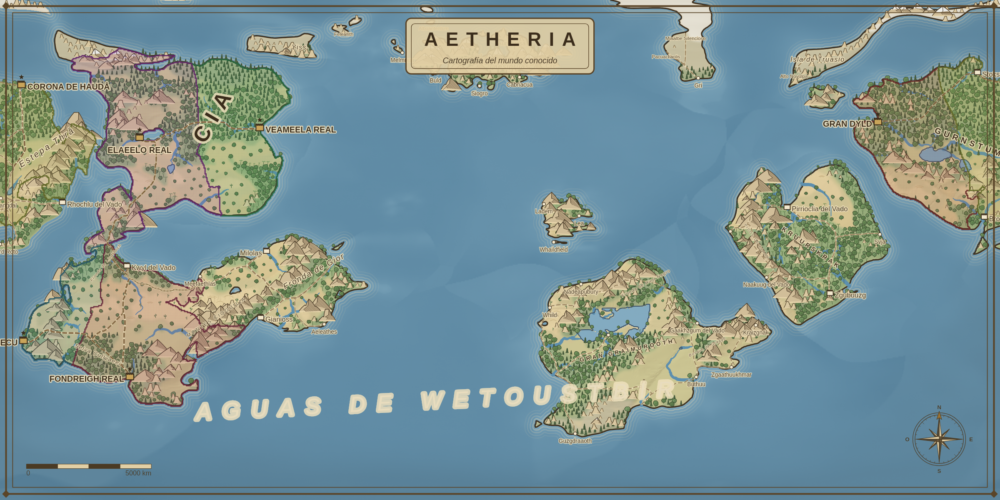
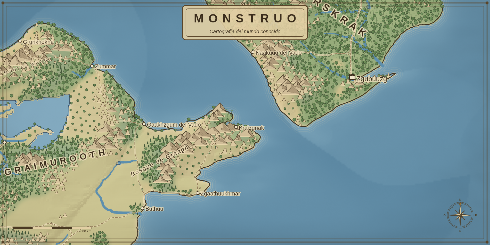
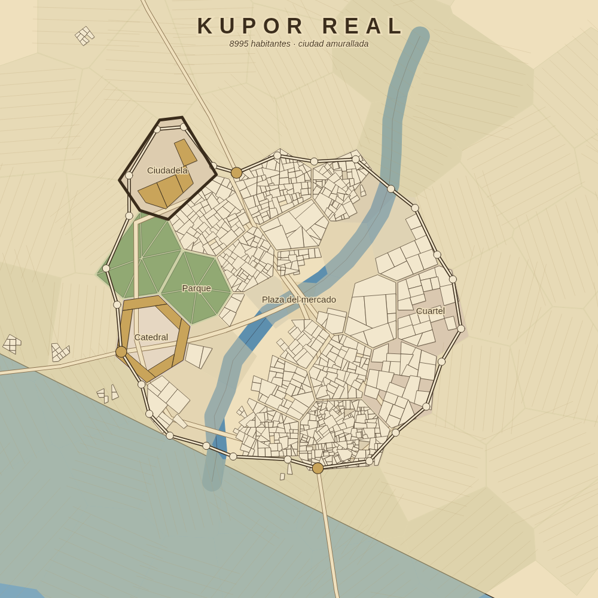
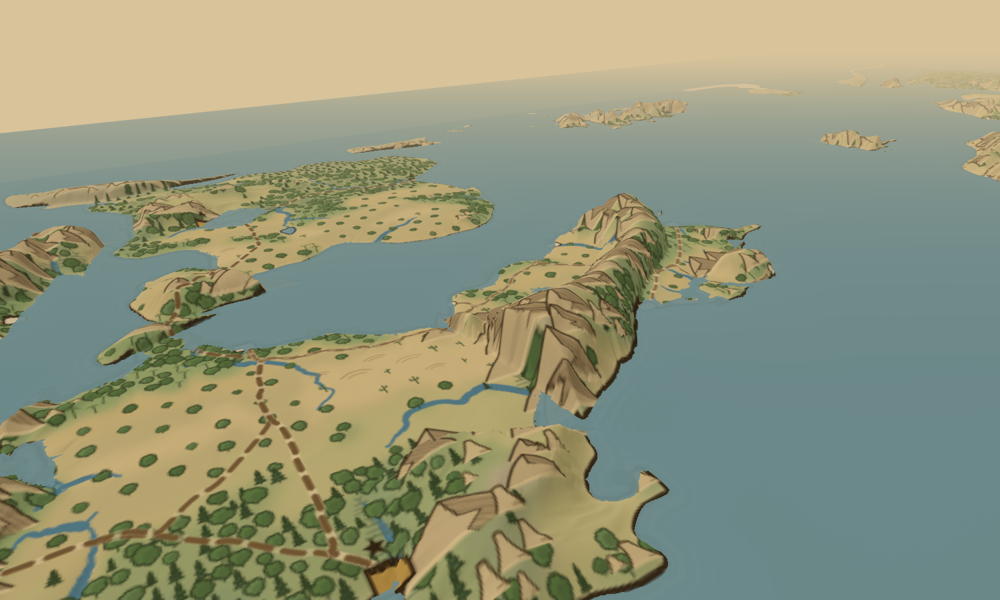

# Writers Hoard — Escritorio

Una aplicación de escritorio local para escribir libros y construir mundos: manuscritos, un Códex de fichas, mapas, líneas de tiempo, tablas y una wiki sin conexión, con un puente de IA para que asistentes externos trabajen en el mismo proyecto.

[English](README.md) · [Empezar](#empezar) · [Conexión con Faustus](#conexión-con-faustus-y-la-familia-hoard) · [Puente de IA](docs/AI-BRIDGE.md) · [Autoría de mundos](docs/WORLD_AUTHORING.md)

## Qué es

Writers Hoard es una app Electron (React, Vite y Dexie, la misma base de código que la versión web) que guarda todo en tu ordenador. Supera el límite de almacenamiento del navegador, incluye descargadores de medios reales (`yt-dlp`, `gallery-dl`) y un motor de documentos en Rust, y no necesita ningún servidor aparte. Los proyectos son mundos: cada uno tiene sus manuscritos, su Códex, mapas, líneas de tiempo y herramientas, con épocas con nombre opcionales sobre una base compartida.

Es además el plugin Writer de la familia Hoard. Absorbe como módulos independientes las antiguas apps de ficción interactiva, biblioteca y edición, y expone un puente de IA local (MCP) con herramientas nativas para leer y editar el proyecto, con deshacer para lo que cambie un asistente.

## Qué hace

**Escritura**
- Editor de documentos enriquecido: estilos, fuentes, colores, tablas, notas al pie, saltos de página, un menú «/» con 26 bloques (llamadas, cajas de lectura en voz alta, mensajes, cartas, bloques de preparación de partida), capítulos con antetítulo e imagen de cabecera, varios manuscritos por mundo.
- Motor de documentos nativo (Rust) para DOCX, PDF y otros formatos, panel de Cambios con propuestas ancladas, estilos editoriales con nombre, encabezados y pies, ortografía local en español y gramática opcional (LanguageTool, requiere Java 17+), y una comprobación de documentos contra reglas de documentación.
- Continuación sugerida (texto fantasma): desactivada por defecto, solo con modelos locales, Tab para aceptarla.
- Notas con listas de tareas y tableros kanban, esquemas, diario, storyboards, planificador de vídeo, lectura beta y auditoría de punto de vista.
- Continuidad: los viajes de cada personaje comprobados contra las fechas del mundo de los capítulos con el motor de rutas (tramos imposibles marcados en el mapa y fecha mínima válida propuesta) y libro de estado por capítulo: dónde está cada personaje, qué sabe, qué lleva, su estado físico y si vive, con comprobación de contradicciones.
- Voz por personaje: perfil de los diálogos de cada personaje sacado del manuscrito (longitud de frase, léxico propio, muletillas, tratamiento, registro), parlamentos que suenan a otro y prueba ciega de quién dice qué.
- Radiografía de ritmo: diálogo, narración y descripción, longitud y densidad de acción por escena y capítulo, en una curva sobre los beats del esquema que señala los tramos planos o desequilibrados.
- Importaciones: carpetas Markdown de Obsidian, Notion, World Anvil y Campfire, documentos mixtos, texto pegado, PDF con texto y manuscritos ePub.

**Construcción de mundos**
- Códex de fichas tipadas con propiedades, alias, tipos privados, fichas congeladas, relaciones, grafo del mundo, genealogía y árboles familiares.
- Generador de mundos y cartografía: mundos generados con etiquetas editables, sellos, caminos, ríos, niebla por capítulo, viajes planificados con el ritmo propio del mundo, ciudades, hojas regionales, vista 3D y mapas clásicos dibujados o sobre imagen con chinchetas, regiones, rutas y herramienta de medición.
- Líneas de tiempo con calendarios propios, lunas, épocas, repeticiones, bandas y vistas guardadas; árboles de relaciones; gráficos de radar; diccionarios y glifos de lenguas inventadas; tablas tipadas y hojas de cálculo con fórmulas e importación y exportación de Excel.
- Anotaciones y comentarios con estado de lectura y chinchetas en tableros; tableros con fichas, audio y vídeo.
- SDK de herramientas locales: crea tus propias herramientas como documentos Source con campos, índices, tutoriales, iconos, traducciones y audio. Ver [docs/local-tool-sdk.md](docs/local-tool-sdk.md).

**Mesa de juego y ficción interactiva**
- Fichas de personaje de D&D 5e, Daggerheart y La llamada de Cthulhu 7e, compendio SRD 5.2 sin conexión, encuentros y seguimiento de combate, bandeja de dados, generadores de nombres y reglas por mesa.
- Ficción interactiva: mundos, continuidad, sesiones, dados, hilos, relojes, narración, voz e ilustraciones, cada uno con su propio interruptor. Ver [docs/FICTION.md](docs/FICTION.md).

**Investigación**
- Proyectos de investigación con fuentes graduadas y retractables, afirmaciones derivadas de extractos registrados, cronología con contradicciones, hipótesis rivales, búsquedas de entidades en Wikidata e informes en Markdown con comprobación de citas. Las personas privadas nunca se enriquecen.

**Publicación y exportación**
- Wiki sin conexión con perfiles con nombre, 20 paletas, diseños de terminal, mapas con zoom y ediciones locales con lista de cambios.
- Exportación de libros a HTML, PDF, DOCX y ePub con portadas, estilos de libro y vistas previas por dispositivo; compilador de biblia del mundo; exportación del mundo entero a Markdown en un ZIP; exportación por ficha; copias de seguridad del proyecto en JSON y ZIP.
- Módulos de biblioteca y publicación con enlaces de lectura, papeleo y herramientas PDF (mediante Links Hoard y Kafka's Hoard), inicialmente apagados.

**Asistencia**
- Panel de copiloto de Faustus compartido en la app, ajustes de IA para proveedores por API, modelos locales y tu propia suscripción de Claude o Codex, estudio de imágenes, audio local (paisajes sonoros, sonidos del lector) y síntesis de voz.
- Temas del espacio de trabajo, paneles acompañantes con pestañas, visitas guiadas, biblioteca de recursos con seguimiento de uso y compresión, y actualizaciones automáticas.

## Empezar

Requisitos: Node.js y npm; Windows es la plataforma principal. La gramática necesita Java 17+; compilar el motor de documentos necesita la cadena de herramientas de Rust fijada.

```bash
npm install            # instalación única de dependencias
npm run fiction:setup  # worker de desarrollo; incluido en las versiones instaladas
npm run fetch:bin      # descarga yt-dlp + gallery-dl en resources/bin/
npm run verify:quick   # tipos de renderer/Electron, lint, conformidad
npm run dev:desktop    # servidor Vite + ventana Electron (HMR)
```

En Windows, `setup.bat` hace la preparación única y `run.bat` arranca la app sin reinstalar. `npm run dev` ejecuta solo la app web en el navegador. Los instaladores se generan con `npm run dist` en `release/`; las versiones y la actualización automática se describen en [docs/RELEASES.md](docs/RELEASES.md).

## Conexión con Faustus y la familia Hoard

- **Plugin.** Writer se declara en [`faustus-plugin.json`](faustus-plugin.json) (id `writer`). El puente de IA está apagado por defecto: actívalo en **Ajustes > Puente de IA**. Entonces responde en `127.0.0.1:8766` (`/api/health` no pide token; todo lo demás exige el token del puente, guardado en tu perfil). Faustus lanza el adaptador stdio que trae la app.
- **Herramientas MCP.** El puente expone herramientas `wh_*` que cubren proyectos y contexto, escritos, fichas del Códex, notas, esquemas, mapas y generación de mundos, líneas de tiempo, tablas, tableros, anotaciones, recursos, importaciones y exportaciones, publicación, investigación, temas y el SDK de herramientas locales; más las herramientas de ficción. Las escrituras se comprueban por revisión y se pueden deshacer. Se pueden crear y revocar claves de acceso con nombre por cliente. Referencia completa: [docs/AI-BRIDGE.md](docs/AI-BRIDGE.md).
- **Copiloto de Faustus.** El copiloto de escritorio monta el panel de chat compartido de Faustus; Faustus gestiona conversaciones, modelos y memoria, y Writer aporta el proyecto, el manuscrito y la selección en vivo. `WH_FAUSTUS_URL` elige el servicio (por defecto `http://127.0.0.1:7000`). Ver [docs/FAUSTUS-COPILOT.md](docs/FAUSTUS-COPILOT.md).
- **Asistentes externos.** Claude Desktop, Codex o Gemini CLI pueden conectarse al puente; **Ajustes > Puente de IA** da la configuración de cada cliente. Ver [docs/ai-external-connection.md](docs/ai-external-connection.md) y [docs/ai-subscriptions.md](docs/ai-subscriptions.md).
- **Traspasos.** Un personaje del Códex puede enviarse a Prospero's Hoard como miembro del reparto, un storyboard como producción, y un mundo puede ir y volver de Scheherazade como documento neutro `hoard.world/1`. Las importaciones crean registros nuevos y se pueden deshacer.
- **Otros Hoards.** Links Hoard, Kafka's Hoard y el Hoard Hub se encuentran a través del hub; una barra indica si cada uno está en marcha y lo arranca.
- **Skills.** La app lleva skills de la biblioteca de la familia para los agentes conectados: `manuscript-continuity-edit`, `writing-plans`, `notes-from-templates` y otras para sus módulos absorbidos.

## Pantallas

<details>
<summary>Mapas generados</summary>









</details>

## Estructura del proyecto

| Ruta | Contenido |
| --- | --- |
| `src/` | Renderer React: páginas, componentes, i18n y `engines/` (una carpeta por área funcional: escritos, códex, mapas, worldgen, líneas de tiempo, tablas, ficción, investigación, publicación y más) |
| `electron/` | Proceso principal, preload, servicio de medios integrado, puente de IA, actualización automática |
| `native/` | Motor de documentos en Rust propio y otros módulos nativos |
| `publishing/` | Motor editorial y de publicación |
| `scripts/` | Scripts de compilación, descarga, pruebas y conformidad |
| `tests/` | Fuentes de las pruebas |
| `docs/` | Guías de puente de IA, autoría de mundos, editor, publicación, ficción, SDK y versiones |
| `skills/` | Procedimientos para los agentes conectados |
| `resources/` | Binarios incluidos (los descarga `fetch:bin`) y recursos |

## Desarrollo

| Script | Qué hace |
| --- | --- |
| `dev` / `dev:desktop` | Solo app web / Vite + Electron con recarga en caliente |
| `build` / `build:desktop` | Comprueba tipos y compila el renderer / compilación completa de escritorio |
| `typecheck:renderer`, `typecheck:electron` | Comprobaciones de tipos |
| `lint:shipping` | Lint contra la base de referencia versionada (los problemas nuevos fallan) |
| `conformance` | Comprueba registro de motores, esquema, idiomas, copias de seguridad y declaración de binarios |
| `verify:quick` | Ambas comprobaciones de tipos, lint y conformidad |
| `verify:release` | Auditoría de dependencias, comprobaciones rápidas, pruebas críticas, compilación de producción y presupuesto de bundle |
| `test:critical` | Pruebas aisladas de Electron para migración, copias, recuperación y renderizado |
| `test:inquiry`, `test:family`, `test:ghost`, `test:subscriptions`, `test:worldgen` | Suites específicas por área |
| `test:packaged` | Prueba de humo de la app de escritorio compilada con un perfil temporal |
| `fetch:bin` | Descarga `yt-dlp` y `gallery-dl`, verificados contra sumas fijadas |
| `dist` / `dist:publish` | Genera un instalador / firma y publica una versión |

La integración continua (`.github/workflows/ci.yml`) verifica, prueba y compila en cada push. Las versiones publicadas para Windows exigen credenciales de firma de código; `npm run dist` local genera instaladores sin firmar.

## Datos y licencia

Los datos del proyecto viven en el perfil de la app (IndexedDB más medios), con copias ZIP rotativas en `%APPDATA%/writers-hoard/backups`; los módulos nativos pueden reubicarse en `data/native/<módulo>`. La sincronización con Google Docs es opcional; todo lo demás funciona sin conexión. Los avisos de terceros están en [`THIRD_PARTY/`](THIRD_PARTY) y el contenido SRD se acredita bajo CC BY 4.0.
