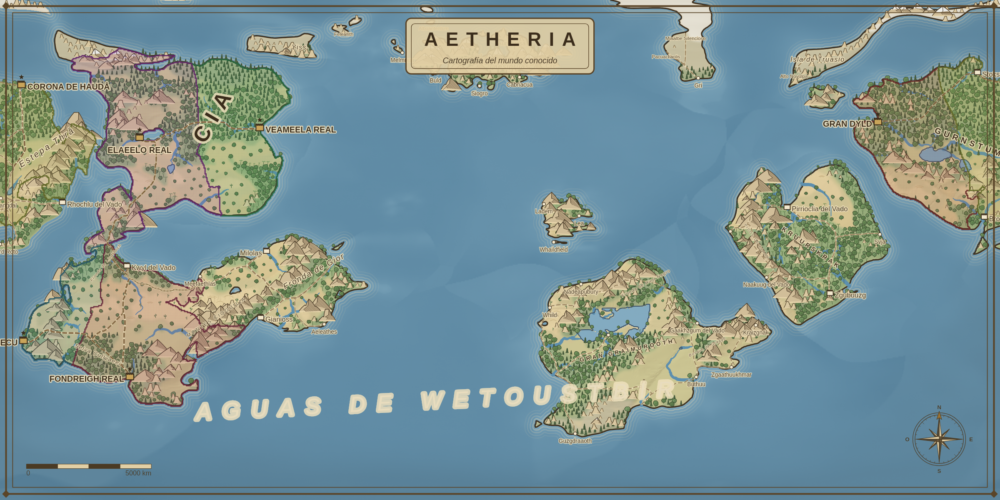
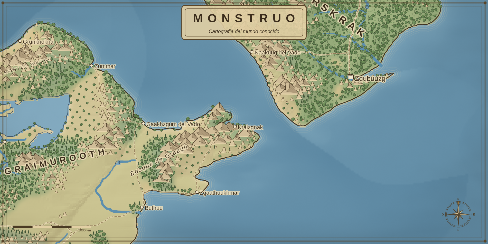
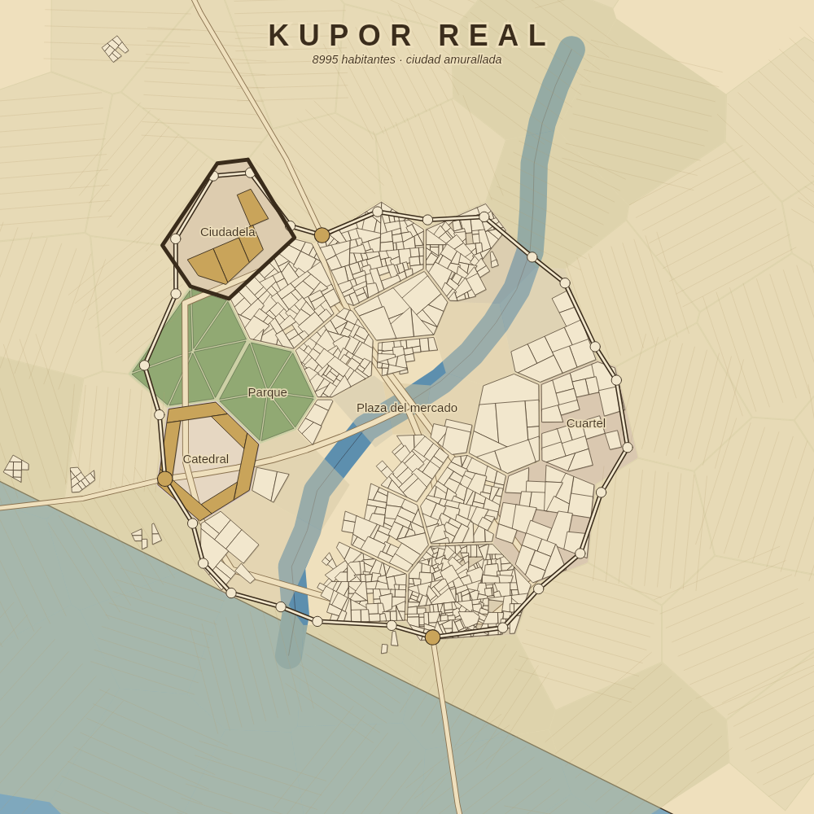
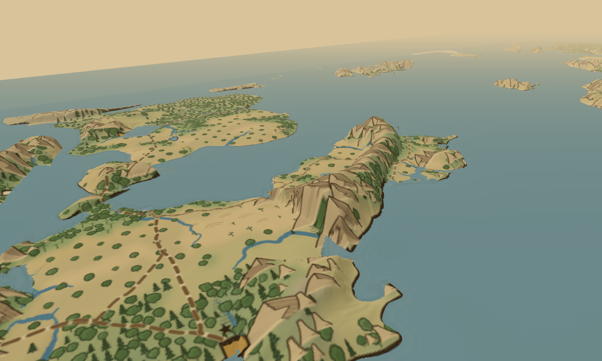

# Writers Hoard — Desktop

A local-first desktop app for writing books and building worlds: manuscripts, a Codex of cards, maps, timelines, tables and an offline wiki, with an AI bridge so external assistants can work in the same project.

[Español](README.es.md) · [Quick start](#quick-start) · [Connection with Faustus](#connection-with-faustus-and-the-hoard-family) · [AI bridge](docs/AI-BRIDGE.md) · [World authoring](docs/WORLD_AUTHORING.md)

## What it is

Writers Hoard is an Electron app (React, Vite and Dexie, the same codebase as the web build) that keeps everything on your computer. It lifts the browser storage ceiling, bundles real media downloaders (`yt-dlp`, `gallery-dl`) and a Rust document engine, and needs no separate server. Projects are worlds: each holds its own manuscripts, Codex, maps, timelines and tools, with optional named eras layered over a shared base.

It is also the Writer plugin of the Hoard family. It absorbs the former interactive-fiction, library and editorial apps as independent modules, and it exposes a local AI bridge (MCP) with native tools for reading and editing the project, with undo for what an assistant changes.

## What it does

**Writing**
- Rich document editor: styles, fonts, colours, tables, footnotes, page breaks, a "/" menu with 26 blocks (callouts, read-aloud boxes, messages, letters, game-prep blocks), chapters with kickers and header images, several manuscripts per world.
- Native document engine (Rust) for DOCX, PDF and other formats, a Changes panel with anchored proposals, named editorial styles, headers and footers, local Spanish spelling and optional grammar (LanguageTool, needs Java 17+), and a document check against documentation rules.
- Suggested continuation (ghost text): off by default, local models only, Tab to accept.
- Notes with to-do lists and kanban boards, outlines, diary, storyboards, a video planner, beta-reading and a POV audit.
- Continuity: every character's journeys checked against the chapters' world dates with the route engine (impossible legs marked on the map, earliest valid date offered), and a chapter-by-chapter state ledger of where each character is, what they know and carry, their condition and whether they live, with contradiction checks.
- Imports: Markdown folders from Obsidian, Notion, World Anvil and Campfire, mixed documents, pasted text, text PDFs and ePub manuscripts.

**Worldbuilding**
- Codex of typed cards with properties, aliases, private types, frozen cards, relations, a world graph, genealogy and family trees.
- World generator and cartography: generated worlds with editable labels, stamps, roads, rivers, fog by chapter, journeys planned with the world's own pace, cities, regional sheets, a 3D view and hand-drawn or image-based classic maps with pins, regions, routes and a measuring tool.
- Timelines with custom calendars, moons, eras, repeats, banners and saved views; relation trees; radar charts; dictionaries and constructed-language glyphs; typed tables and spreadsheets with formulas and Excel import and export.
- Annotations and comments with read state and board pins; boards with cards, audio and video.
- Local tool SDK: author your own tools as Source documents with fields, indexes, tutorials, icons, translations and audio. See [docs/local-tool-sdk.md](docs/local-tool-sdk.md).

**Tabletop and interactive fiction**
- Character sheets for D&D 5e, Daggerheart and Call of Cthulhu 7e, an offline SRD 5.2 compendium, encounters and a fight tracker, a dice tray, name generators and per-table rules.
- Interactive fiction: worlds, continuity, sessions, dice, threads, clocks, narration, voice and illustrations, each behind its own switch. See [docs/FICTION.md](docs/FICTION.md).

**Investigation**
- Research projects with graded and retractable sources, claims derived from recorded excerpts, chronology with contradictions, competing hypotheses, entity lookups against Wikidata and Markdown reports with a citation check. Private persons are never enriched.

**Publishing and export**
- Offline wiki with named profiles, 20 palettes, terminal layouts, zoomable maps and local editions with a change list.
- Book export to HTML, PDF, DOCX and ePub with covers, book styles and device previews; a world bible compiler; whole-world Markdown export as a ZIP; per-card export; project backups in JSON and ZIP.
- Library and publishing modules with reading links, paperwork and PDF tools (through Links Hoard and Kafka's Hoard), initially off.

**Assistance**
- Shared Faustus copilot panel in the app, AI settings for API providers, local models and your own Claude or Codex subscription, an image studio, local audio (soundscapes, reader sounds) and text-to-speech.
- Workspace themes, companion panes with tabs, guided tours, an assets library with usage tracking and compression, and auto-updates.

## Quick start

Requirements: Node.js and npm; Windows is the primary target. Grammar checking needs Java 17+; building the document engine needs the pinned Rust toolchain.

```bash
npm install            # one-time dependency setup
npm run fiction:setup  # development worker; included in installed builds
npm run fetch:bin      # downloads yt-dlp + gallery-dl into resources/bin/
npm run verify:quick   # renderer/Electron types, shipping lint, conformance
npm run dev:desktop    # Vite dev server + Electron window (HMR)
```

On Windows, `setup.bat` performs the one-time setup and `run.bat` starts the app without reinstalling. `npm run dev` runs the plain web app in a browser. Installers are built with `npm run dist` into `release/`; releases and auto-update are described in [docs/RELEASES.md](docs/RELEASES.md).

## Connection with Faustus and the Hoard family

- **Plugin.** Writer declares itself in [`faustus-plugin.json`](faustus-plugin.json) (id `writer`). The AI bridge is off by default: turn it on in **Settings > AI bridge**. It then answers on `127.0.0.1:8766` (`/api/health` needs no token; everything else needs the bridge token, kept in your profile). Faustus launches the stdio adapter shipped with the app.
- **MCP tools.** The bridge exposes `wh_*` tools covering projects and context, writings, Codex cards, notes, outlines, maps and world generation, timelines, tables, boards, annotations, assets, imports and exports, publishing, investigation, themes and the local tool SDK; plus the fiction tools. Writes are revision-checked and undoable. Named access keys can be created and revoked per client. Full reference: [docs/AI-BRIDGE.md](docs/AI-BRIDGE.md).
- **Faustus copilot.** The desktop copilot mounts Faustus's shared chat panel; Faustus owns conversations, models and memory, Writer supplies the project, manuscript and live selection. `WH_FAUSTUS_URL` selects the service (default `http://127.0.0.1:7000`). See [docs/FAUSTUS-COPILOT.md](docs/FAUSTUS-COPILOT.md).
- **External assistants.** Claude Desktop, Codex or Gemini CLI can connect to the bridge; **Settings > AI bridge** gives per-client configuration. See [docs/ai-external-connection.md](docs/ai-external-connection.md) and [docs/ai-subscriptions.md](docs/ai-subscriptions.md).
- **Hand-offs.** A Codex character can be sent to Prospero's Hoard as a cast member, a storyboard as a production, and a world can travel to and from Scheherazade as a neutral `hoard.world/1` document. Imports create new records and can be undone.
- **Other Hoards.** Links Hoard, Kafka's Hoard and the Hoard Hub are found through the hub; a bar shows whether each is running and starts it.
- **Skills.** The app carries skills from the family library for connected agents: `manuscript-continuity-edit`, `writing-plans`, `notes-from-templates` and others for its absorbed modules.

## Screens

<details>
<summary>Generated maps</summary>









</details>

## Project layout

| Path | Contents |
| --- | --- |
| `src/` | React renderer: pages, components, i18n, and `engines/` (one folder per feature area: writings, codex, maps, worldgen, timeline, tables, fiction, inquiry, publishing and more) |
| `electron/` | Main process, preload, embedded media service, AI bridge, auto-update |
| `native/` | Owned Rust document engine and other native modules |
| `publishing/` | Editorial and publishing engine |
| `scripts/` | Build, fetch, test and conformance scripts |
| `tests/` | Test sources |
| `docs/` | AI bridge, world authoring, editor, publishing, fiction, SDK and release guides |
| `skills/` | Procedures for connected agents |
| `resources/` | Bundled binaries (downloaded by `fetch:bin`) and assets |

## Development

| Script | What it does |
| --- | --- |
| `dev` / `dev:desktop` | Web app only / Vite + Electron with hot reload |
| `build` / `build:desktop` | Typecheck and build the renderer / full desktop build |
| `typecheck:renderer`, `typecheck:electron` | Type checks |
| `lint:shipping` | Lint against the checked-in baseline (new problems fail) |
| `conformance` | Checks engine registration, schema, locales, backup and binary declarations |
| `verify:quick` | Both typechecks, lint and conformance |
| `verify:release` | Dependency audit, quick checks, critical tests, production build and bundle budget |
| `test:critical` | Isolated Electron tests for migration, backup, recovery and rendering |
| `test:inquiry`, `test:family`, `test:ghost`, `test:subscriptions`, `test:worldgen` | Focused suites per area |
| `test:packaged` | Smoke test of the built desktop app with a temporary profile |
| `fetch:bin` | Download `yt-dlp` and `gallery-dl`, verified against pinned checksums |
| `dist` / `dist:publish` | Build an installer / sign and publish a release |

CI (`.github/workflows/ci.yml`) verifies, tests and builds on every push. Published Windows releases require code-signing credentials; local `npm run dist` builds unsigned installers.

## Data and licence

Project data lives in the app's profile (IndexedDB plus media), with rotating ZIP snapshots under `%APPDATA%/writers-hoard/backups`; native modules can be relocated into `data/native/<module>`. Google Docs sync is optional; everything else works offline. Third-party notices are in [`THIRD_PARTY/`](THIRD_PARTY) and the SRD content is credited under CC BY 4.0.
